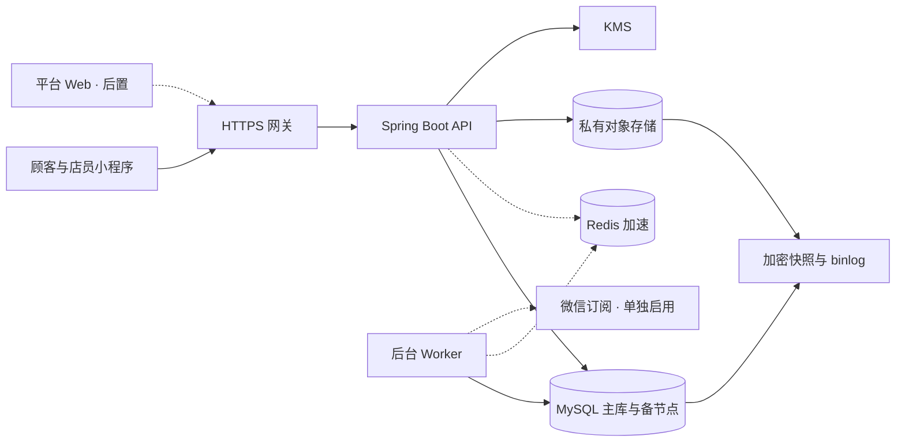

# 11｜运行、故障降级与恢复

本文记录首发运行配置及恢复目标。部署时登记环境、配置版本、负责人及验收证据。窗口从服务端 UTC 计算，明确标记的经营规则按 Asia/Shanghai。

## 1. Redis、锁与保留窗口

键前缀 `np:{env}:v1:`，环境使用独立实例或集群及凭证。用户、门店等取稳定非秘密标识，手机号或第三方身份如需参与风控，使用环境隔离的 HMAC 摘要。Redis 使用 TLS、受限 ACL、内存监控，鉴权与限频不读取从库旧值。

| 作用 | 建议键及有效期 | 权威数据及故障行为 |
|---|---|---|
| 小程序会话提示 | `sess:{appid}:{token_digest}`，TTL 为数据库闲置、绝对截止中的较小剩余时间，Redis 单键不超过 2 小时 | MySQL 按当前会话、AppID、用户、门店及员工版本重新授权。缓存未命中或 Redis 故障，限流后走同一数据库路径。已明确撤销的摘要短存至原绝对截止即可。 |
| 登录挑战 | 无可独立消费的 Redis 凭证。Redis 只承担入口限频 | MySQL 5 分钟手机认证、3 分钟换绑，截止后失效。每分钟回收 500 条到期记录，先子后父。 |
| 门店公开目录 | `catalog:{store_id}:{projection}:{version}`，60 秒并添加 0–10 秒随机抖动 | 只缓存公开白名单。当前版本从权威源读。短暂数据库故障时可使用已知仍可公开且未超过 5 分钟的备用快照；无法判断门店状态时隐藏状态、可预约性和库存承诺，仅服务已确认仍允许展示的静态信息。 |
| 券锁提示 | `coupon-hint:{store_id}:{coupon_instance_id}`，到数据库锁最迟 3 分钟内 | 锁本体为 V001 锁券行和令牌。DB 锁期限取报价窗口与券本身有效期较小值，结算时复核。Redis 丢失不改变占用期限。 |
| 幂等定位 | `idem:{scope}:{action}:{key_digest}`，10 分钟 | 只放结果指针。摘要和授权从 DB 重验，同键异参返回 409；响应丢失按同键恢复。 |
| 任务唤醒 | `wake:{queue}`，短通知最长 60 秒 | 保底 DB 扫描持续运行。缓存键丢失不影响 Outbox、商品或预约截止。 |
| 短期调度互斥 | `job-hint:{job}:{shard}`，示例 10 秒 | 锁只抑制重复扫描。用随机令牌 `SET ... NX PX`，用原子比较令牌删除；过期的持有者不得删除新锁。实际写入按 MySQL 行锁、幂等或租约令牌控制。 |
| 跨店风险额度提示 | `risk-quota:{store_id}:{subject_digest}:{YYYYMM}`，至北京时间月末 | 按正式规则每店、每顾客、每自然月 3 次，业务核验与计次由 MySQL 完成。不可用时按当前流程提示查询不可用，不伪造“未查到风险”。 |

会话每天按 `ix_session_expiry` 分批清理超过绝对截止 7 天的行，单批最多 500。已登出可立即从缓存移除，数据库墓碑保留至同一清理窗口。邀请码密封内容在原 12/72 小时截止后清理，结果回执按发码域长期保留。批量任务运行 1 秒就提交，避免阻塞营业时的业务写入。

## 2. Outbox 投递、租约和外部不确定状态

1. 写业务事实时插入唯一事件键，使用不含个人资料的域、原对象、已提交转换版本和事件名。payload 只带必要标识及投影依据。API 响应依业务提交结果，消息失败保留原业务。
2. Worker 每 2 秒用 `ix_outbox_due` 领取至多 50 条，事务中按 `next_attempt_at, outbox_event_id` 排序，`FOR UPDATE SKIP LOCKED`，逐条赋予随机 128 位令牌和 30 秒租约。领取事务只写租约即提交。线程池按最大在制量领取，单外部请求预算 5 秒。申请续租者须持当前令牌、租约未到期，每次延长 30 秒、总工作许可最长 2 分钟；超预算交回或进入受控排查。
3. 站内消息使用 V001 的事件＋收件人＋类型唯一约束。投影事务锁事件并重验令牌、租期、当前收件权限，按原通知例外生成最小业务摘要。站内投影已提交后重试不重复生成。仅普通、重要两档，已中止及正常补图或改普通说明不额外发送通知。
4. 微信订阅渠道单独保存发送意图。事务锁父事件并重验令牌及渠道状态后将子行从 ready/retry 写为 sending，记录 send_token；提交后再调用微信。成功回写须同时满足父令牌未更换、租期有效及子令牌匹配。明确未送达且可重试时安排下次；已确认不应发送记 skipped。结果未知的 sending 只能通过渠道可验证回查，或确有提供方幂等保证的同键重投恢复。无证据时标 `needs_review`，避免重复通知。发送最终状态取决于真实渠道结果。短信暂未开放。
5. 每 5 秒用 `ix_outbox_stale_lease` 处理到期租约，`lease_until <= now` 进入回收。回收同事务保存子渠道未决结果，释放旧 token。重新领取写新 token；旧 worker 的回写、续租均须影响 0 行。确定可重试的失败按 5、30、120、300、900、1800、3600 秒（加 0–20% 抖动）重试，最多 8 次总尝试含首发。超过预算进入 `needs_review` 并告警。父事件只有必要站内及已启用渠道均完成才 delivered，有未知外部结果则标 needs_review。
6. 监视到期积压年龄、租约回收次数、未知发送和重试上限。首发告警值为最旧 ready/pending 超 60 秒持续 5 分钟、任一未决外部发送和持续租约过期。恢复由原事件及同一渠道记录处理。站内通知引用父事件，清理父行须先按留存规则一致归档及校验引用，首批不批量删除有引用事件。

## 3. 商品预占超时与账本幂等

### 3.1 预占扫描

- 确认商品需求时固定该单的 `order_hold_expires_at`，逐行复制同一截止到预占。原门店规则默认 24 小时，关闭自动取消存 NULL。读写都从服务端权威时间判断，缓存和软件打开时间不延长截止。
- 每 15 秒按 `ix_reservation_due` 对 held 且截止非空、已到期行扫描，每轮 100 条候选，按截止和行 ID 排序、按原订单去重。候选扫用无锁读取；处理每单在主库先锁原订单再按 SKU 和行 ID 稳定锁定。重验订单类型、状态、应收版本、结算事实、截止及原预占。允许的超时仅一次将订单置 expired、写原预占 released、扣除对应库存预占计数、记录审计和 Outbox。商品原总库存、售出和实收保持真实。已成交、无期限、版本变动或无原预占按当前事实退出；对异常快照告警人工核对。
- 常规收款或免单使用相同根锁，锁后重验截止和结算条件。到达截止时已成功成交事实保留，未成功且过期则提示核对原结果。已在线下真实收款并交货的超时单走 03e §13.1 原单关联补记；保留原取消和库存释放，原单最多关联一次新成交。动作按账本原样履行，不恢复旧单或他人库存。
- Redis 和 worker 重启后从主库补扫，连续 1 分钟无扫描心跳或最早到期积压超过 60 秒持续 5 分钟告警。无需等待后台任务标记才按截止拒绝过时状态修改。

### 3.2 幂等清理

| 范围 | 保留窗口及判定 |
|---|---|
| 通用重试 | 客户端网络异常先回查原单，再用原键和原规范化摘要重试；推荐当次任务 24 小时内处理。服务端回执与事实同事务提交。 |
| 有确定持久防重锚的操作 | 已完成回执保留至少 30 天。仅当操作在批准清单内且清理后原对象、一次性事实或已消费原版本仍可明确拒绝陈旧同键请求，才允许分批删除。首发清理清单默认为空。 |
| 任意创建、发码、账本及不可证明永久防重的操作 | 回执和唯一作用域键与业务留存周期一致，单独审查销毁政策。发码只删除过期密文，保留回执以阻止旧键重新产生邀请码。 |
| 清理运行 | 每日按 `ix_idem_created_at` 扫已完成历史，每批最多 500；同时核对 completed_at、动作白名单及持久锚。存在密封外键需先过期清理，并排除发码回执。提交后遗留 processing 行异常告警，不主动重置为可执行。 |

## 4. 限频、日志和故障矩阵

### 4.1 发布初始限频

限频以可信网关转发的 IP 与服务端确定的身份维度为准。相同请求同时通过相关维度才通行。使用 Redis 原子计数及得到截止后设置 TTL，集群使用可执行单键原子操作的独立计数，任一维度超额返回 429、`Retry-After` 和 `TOO_MANY_REQUESTS`。按业务峰值和误拦比例再调优。

| 接口 | 候选上限 | Redis 故障 |
|---|---|---|
| 公开目录读取 | 每 IP 120 次／分钟，单实例另设并发保护 | 本地限流并控制主库读并发，有权限的公开投影可继续。 |
| 微信短码交换 | 每 IP 30 次／分钟、每 AppID 300 次／分钟 | 暂停新认证，已有效会话可查主库继续服务。 |
| 手机认证 / 换绑确认 | 每挑战 5 次／5 分钟，每 IP 15 次／分钟，已验真号码摘要 5 次／15 分钟 | 暂停新的认证/换绑。一次性消费仍由 DB 管。 |
| 顾客业务写、店员写 | 各自每 User 60 次／分钟，另有限额保护门店和全局写队列 | 既有会话通过 MySQL 权威校验，实例本地保守限流，保护 DB 连接池及突发流量。 |
| 私有媒体申请、下载 | 每 User 20 次上传意图／分钟、60 次下载／分钟 | 正常权限核对和本地限流；附件授权或安全扫描故障时只降级媒体能力。 |
| 未来平台账号登录 | 每身份与 IP 5 次／15 分钟；管理员入口另设网关保护 | 平台模块后置，单独验证恢复；不影响双端。 |

### 4.2 日志与密钥

- 可观测字段采用白名单，记录 `request_id`、操作、路由模板、结果码、延迟、非秘密内部 ID、必要对象版本和部署版本。返回客户端的 request_id 供客服定位。结构化日志默认留存 30 天（候选），按生产角色授权查阅。业务审计事实沿原目录、权限和批准的留存周期保存。
- 隐藏完整手机号、微信标识、手机号凭证、登录短码、挑战、Cookie、Bearer、码值、支付证明原件、营业执照、入库图片和签名 URL。APM、重试队列、错误日志、反向代理和数据库慢查采样执行相同白名单；禁止记录带查询参数的原始媒体路径。客服记录脱敏后引用原对象。密钥于 Secret Manager／KMS，按用途隔离、可轮换和审计。

### 4.3 故障行为

| 故障 | 双端表现与恢复 |
|---|---|
| Redis 节点丢失或清库 | 会话与原业务事务从 MySQL 恢复，认证敏感入口按限频降级；DB 扫描继续，库存、券、Outbox 不发生二次确认。 |
| MySQL 不可用或主从切换 | 私有读和写按契约返回 503，明确可能提交时提示同键查原结果。仅允许有效且已知可公开的缓存，恢复后先校验当前主库身份和租约。 |
| 微信登录或订阅不可用 | 新登录或相应渠道不可用。真实会话按当前权限继续，站内消息照常。外部状态未知走查询或人工。 |
| 对象存储、KMS 或 AI 不可用 | 受影响意图／旧媒体／发码有明确暂不可用。预约、无图服务、收款、正常手录入库及查询可继续。 |
| 平台 Web 或缓存不可用 | 双端高频工作照常，依赖平台的审核和代办按能力开关不可用。 |

## 5. 部署与备份恢复

- 建议首发采用一套生产域名的 TLS 网关加至少两个无状态 API 实例，独立 Worker 部署能按积压扩容。托管 MySQL 8.0 主库与跨可用区备节点、私有 Redis、开启版本管理的私有对象存储及 KMS。小程序仅连 HTTPS 网关，Redis、MySQL、对象原件无公网入口。平台 Web 以后单独域名发布，使用独立凭证与发布门禁。双端一次只上传已验收的产物摘要。
- 区分生产、联调、回放演练和本地数据及密钥。连接池预算按实例数分配并留出运维容量，初始例如每 API 20、每 Worker 8 连接，再由压测校准。日志汇聚、告警、健康检查覆盖 API、MySQL、Redis、任务心跳、KMS 和对象存储。滚动发布遵循迁移兼容，迁移作业独立执行。
- MySQL 每日加密全量备份，持续异地归档 binlog，初始 PITR 保留 14 天，生产 RPO ≤ 5 分钟、RTO ≤ 2 小时。对象存储启用版本保护及隔离备份，目标 RPO ≤ 15 分钟、RTO ≤ 4 小时，私有材料恢复前暂禁访问。备份凭证、密钥与应用进程权限分离。Redis 是可重建层，凭据与锁状态从当前权威事实重新生成。
- 恢复演练在隔离网络执行，先冻结写流量及外部渠道。选择最后完好备份，应用连续 binlog 到指定时间或事务位置，校验快照签名、binlog 连续性、V001/V002 版本及约束。按抽样核实预约、原店身份、原单实收退款余额、库存预占总数、已核销券、站内消息唯一性及对象版本；从一致的数据库引用清单恢复媒体。
- 在恢复点之外的部署控制面分配并固化新的 128 位随机纪元，所有实例完成一致切换后再签发凭证和挑战。废止旧会话、下载票据及旧 Redis。若恢复点后有换绑、停用或授权撤销，先从独立日志或原始记录核对并恢复可确认的操作。无法界定受影响身份时保持私有入口关闭，直至核清。资金及外部通知在恢复差异清账后启用，未知发送、已收未入账、超时预占均进入原单核查。先开放受控读，再开放核心写和 Worker，最后验证双端。
- 记录事故起点、恢复点 UTC、首笔受控验证和对外恢复 UTC、缺失交易范围、对账及审批。恢复点差用于测实际 RPO，事故至业务可受控恢复用于测实际 RTO。上线前完整预演一次，随后至少每季度演练一次，重大迁移后复验。阶段 11 已在本机合成库运行逻辑恢复和按 binlog 位置回放，生产环境演练用于验证 RPO/RTO。
